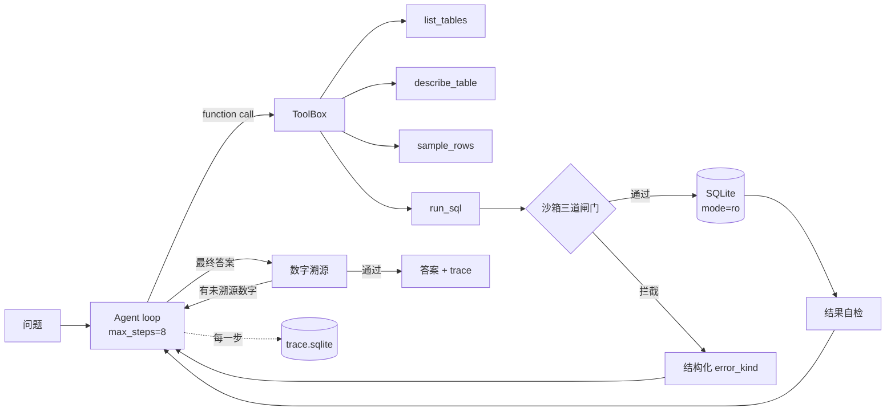

# DataAgent

**不是让 LLM 写 SQL，而是让它在写错的时候知道自己是错的。**

一个带护栏的自然语言查数 Agent。数据用 Olist 巴西电商库（9 张表 / 99,441 单 / 198 MB SQLite），
通过 function calling 让模型自己决定查什么、遇到错误怎么修，最后用一个可审计的 trace 记录全过程。

## 为什么做这个

第一次跑通就有答案，而且是错的：

| 轮次 | 模型给出的答案 | 实际值 | 错在哪 |
|---|---|---|---|
| 1 | 取消率 **6.25%** | 0.63% | 拿到正确的 625 和 99441 之后**心算相除错了一个数量级** |
| 2（加了数字溯源后） | 取消率 **62500%** | 0.63% | 改写 SQL 时 `count(*)` 漏了 `FROM`，SQLite 里恒等于 1，分母变成 1 |
| 3（加了聚合自检后） | "0.63%，**即 63%**" | 0.63% | 单位自相矛盾 |

三次都不是 SQL 语法错，SQL 全都能跑通、都有数据返回。这就是 LLM 最危险的失败模式：
**不报错、很自信、结果错。** 所以这个项目的重心不在"能不能生成 SQL"，而在
"生成之后能不能发现自己是错的"。

## 五道防线

| 防线 | 位置 | 挡住什么 | 实测 |
|---|---|---|---|
| 1. AST 校验 | `sandbox.validate_sql` | 写操作、多语句、未知表、`load_extension` 类函数 | DELETE/UPDATE/PRAGMA 全部拒绝 |
| 2. 只读连接 | `mode=ro` + `PRAGMA query_only` | 校验被绕过时的兜底写入 | 单测覆盖 |
| 3. 执行期中断 | `set_progress_handler` | 无 where 的笛卡尔积（geolocation 100 万行） | 递归 CTE 0.3s 被中断，连接仍可用 |
| 4. 结果自检 | `tools.self_check` + 重复调用检测 | `empty_result` / `suspicious_zero` / `aggregate_without_from` / `suspicious_ratio` / `repeated_call` | 抓住第 2 轮那个 `count(*)` 分母 |
| 5. 数字溯源 | `verify.unsourced_numbers` | 答案里出现但查询结果中没有出处的数字 | 抓住第 1 轮的心算，打回重算一次 |

关键取舍：**`ok=True` 而 `error_kind='empty_result'`**。
"SQL 能跑通"和"答案是对的"是两件事，混在一起就失去了诊断价值。

## 架构



trace 从第一行代码就落库（`runs` / `steps` 两张表，含 `error_kind`、token、耗时、成本），
因为下一个项目 AgentEval 要直接吃这张表做采样噪声与显著性分析。

## 快速开始

```powershell
uv venv .venv --python 3.13
uv pip install --python .venv\Scripts\python.exe -r requirements.txt

copy .env.example .env      # 填 DATAAGENT_API_KEY 和 DATAAGENT_DB

# 不消耗 token 的两个命令
.\run.cmd schema
.\run.cmd sql "select order_status, count(*) n from orders group by 1 order by n desc limit 5"

# agent
.\run.cmd ask "被取消的订单占全部订单的比例是多少？" -v
```

`python evals/run_eval.py --gold-only` 会现场执行 12 条参考 SQL 生成金标准（不花钱、不调模型）。

## 当前结果（12 题首轮基线）

`python evals/run_eval.py`，模型 `glm-4-flash`，prompt `v0.2.0`：

| 指标 | 值 |
|---|---|
| 准确率 | **0.583（7/12）** |
| 平均轮次 | 5.25（max_steps=8） |
| 总 token | 233,829 |
| 总成本 | ¥0（免费模型） |
| 判为失败 | 5 题，其中 **4 题是打满 8 步不收敛**，不是答错 |

按难度：easy 3/3、medium 3/4、hard 2/3、ambiguous 1/2。

人工复核说明（口径要说清楚，否则数字会被误读）：
- q11「销量最好的类目」判错但其实是**判对口径的假阴性**：模型答葡语类目名 `cama_mesa_banho`，金标准用翻译后的 `bed_bath_table`，两者是同一类目，差异来自翻译表覆盖不全。
- 修正后真实准确率约 **8/12 = 0.67**。

## trace 里的失败模式分布

来自 `steps` 表的 `error_kind` 统计（工具调用 72 次）：

| error_kind | 次数 | 含义 |
|---|---|---|
| （正常） | 50 | — |
| `aggregate_without_from` | 8 | 聚合漏 FROM，分母变 1（第 2 轮那个 62500%） |
| `unknown_column` | 4 | 用了别的表的列（`customer_unique_id` 写成 `orders` 的列） |
| `syntax` | 4 | SQL 语法错 |
| `misuse_aggregate` | 4 | 聚合函数嵌套误用 |
| `repeated_call` | 3 | 原样重复提交，模型卡住 |
| `suspicious_zero` | 1 | 结果为 0，多半是 join 丢行 |
| `blocked` | 1 | 被护栏拦下 |

**最重要的一条结论**：护栏能准确标记问题（`repeated_call` 三次全部标中），
但 `glm-4-flash` 拿到"你重复了、必须换写法"的明确提示后仍然原样重试。
**"能让模型知道自己错了"和"模型有能力改对"是两件事**——后者只能靠换模型或换策略，
这也正好是下一个项目 AgentEval 要量化的问题（同一套护栏，不同模型的修复率差多少）。

## Decision Log

- **schema 全塞进上下文，不做向量检索**：9 张表的 DDL + 列注释 + 样例值只有 5.1 KB，
  检索反而会漏表。表数上到几十张、schema 过百 KB 时才值得上 RAG。
- **不引入 LangChain/LangGraph**：loop 只有一百多行，控制流自己握着才能定位
  "模型在哪一步走错"。框架对比实验留到后期用 LangGraph 复刻同一套评测。
- **数字溯源只重试一次**：第二次仍失败就如实标记 `unsourced` 并输出，
  而不是无限重试——无限重试会把失败藏起来，还会烧钱。
- **trace 用 SQLite 而不是接 Langfuse**：本地可查询、零依赖，
  后续需要可视化时再导出 OTel 格式。
- **prompt_version 参与缓存 key**：改提示词必须同步升版本号，
  否则只会读回旧缓存，实验数据全部作废（这个坑在之前的 LLM 标注项目里踩过）。

## 已知局限

1. `glm-4-flash` 心算与单位换算能力弱，三次失败案例都出在这一层；
   换 `glm-4-plus`/`deepseek-chat` 的对照还没跑。
2. 数字溯源只能验证"有没有出处"，验证不了"这条 SQL 语义对不对"——
   第 2 轮 62500% 有出处但仍是错的，靠的是防线 4 而不是防线 5。
3. 护栏只能标记、不能代替模型修复：`repeated_call` 三次全部标记成功，
   模型拿到"必须换写法"的明确提示后仍原样重试——这是 `glm-4-flash` 的能力上限，
   不是护栏的问题，但意味着准确率的上限卡在模型侧。
4. 评测集的判对口径偏宽松（多行题覆盖 50% 即算对），且类目名中英混用造成假阴性，需要人工抽检校准。
5. 没有并发、没有服务化、没有 CI。

## Roadmap

- [ ] 模型对照实验：`glm-4-flash` / `glm-4-plus` / `deepseek-chat` 跑同一套 12 题，
      量化同一套护栏下不同模型的**修复率**差异（这是最有信息量的一格）
- [ ] 评测集扩到 60 题，四种难度各 15 题，人工抽检 20 题校准判对口径
- [ ] 三个 baseline 对照：一次性 prompt / few-shot / 当前 agent loop
- [ ] 补齐指标：执行准确率、平均修复轮次、p95 延迟、单题成本
- [ ] FastAPI 服务化 + Docker
- [ ] 打包成 MCP server，在 Cursor / Reasonix 里直接查数
- [ ] 失败模式分类报告（数据源就是 trace 表的 `error_kind`）
