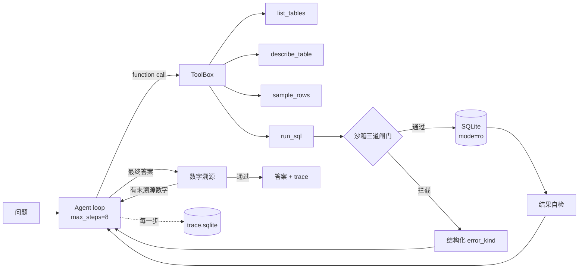

# DataAgent

[](https://github.com/KelpKernel/dataagent/actions/workflows/ci.yml)

**不是让 LLM 写 SQL，而是让它在写错的时候知道自己是错的。**

一个带护栏的自然语言查数 Agent。数据用 Olist 巴西电商库（9 张表 / 99,441 单 / 198 MB SQLite），
通过 function calling 让模型自己决定查什么、遇到错误怎么修，全过程写进可查询的 trace。

## 为什么做这个

第一次跑通就有答案，而且是错的：

| 轮次 | 模型给出的答案 | 实际值 | 错在哪 |
|---|---|---|---|
| 1 | 取消率 **6.25%** | 0.63% | 拿到正确的 625 和 99441 之后**心算相除错了一个数量级** |
| 2（加了数字溯源后） | 取消率 **62500%** | 0.63% | 改写 SQL 时 `count(*)` 漏了 `FROM`，SQLite 里恒等于 1，分母变成 1 |
| 3（加了聚合自检后） | "0.63%，**即 63%**" | 0.63% | 单位自相矛盾 |

三次都不是 SQL 语法错，SQL 全都能跑通、都有数据返回。这就是 LLM 最危险的失败模式：
**不报错、很自信、结果错。** 所以这个项目的重心不在"能不能生成 SQL"，而在
"生成之后能不能发现自己是错的"。

## 五道防线

| 防线 | 位置 | 挡住什么 | 实测 |
|---|---|---|---|
| 1. AST 校验 | `sandbox.validate_sql` | 写操作、多语句、未知表、`load_extension` 类函数 | DELETE/UPDATE/PRAGMA 全部拒绝 |
| 2. 只读连接 | `mode=ro` + `PRAGMA query_only` | 校验被绕过时的兜底写入 | 单测覆盖 |
| 3. 执行期中断 | `set_progress_handler` | 无 where 的笛卡尔积（geolocation 100 万行） | 递归 CTE 0.3s 被中断，连接仍可用 |
| 4. 结果自检 | `tools.self_check` + 重复调用检测 | `empty_result` / `suspicious_zero` / `aggregate_without_from` / `suspicious_ratio` / `repeated_call` | 抓住第 2 轮那个 `count(*)` 分母 |
| 5. 数字溯源 | `verify.unsourced_numbers` | 答案里出现但查询结果中没有出处的数字 | 抓住第 1 轮的心算，打回重算一次 |

关键取舍：**`ok=True` 而 `error_kind='empty_result'`**。
"SQL 能跑通"和"答案是对的"是两件事，混在一起就失去了诊断价值。

## 架构



## 快速开始

```powershell
uv venv .venv --python 3.13
uv pip install --python .venv\Scripts\python.exe -r requirements.txt
copy .env.example .env      # 填 API key 与 DATAAGENT_DB

.\run.cmd schema                                              # 看喂给 LLM 的 schema（5.1 KB）
.\run.cmd sql "select count(*) from orders"                   # 不走 LLM，验证护栏
.\run.cmd ask "被取消的订单占比是多少？" -v                     # agent
.\run.cmd ask "..." --model deepseek-chat --prompt v0.2.0      # 换模型 / 换提示词版本

python evals\run_eval.py --gold-only           # 只跑 60 条参考 SQL 生成金标准，不花钱
python evals\run_eval.py --tag my-run          # 跑全量评测
python evals\compare.py --a A.json --b B.json  # 配对 2x2 + 精确 McNemar
python evals\analyze_trace.py --detail         # 护栏命中率与修复率
python evals\recompute.py --file *.json        # 改判对口径后离线重算，不重跑模型
```

## 结果：四个配置，60 题

| 配置 | 准确率 | easy | medium | hard | ambiguous | 平均步数 | 未收敛 | 成本 |
|---|---|---|---|---|---|---|---|---|
| glm-4-flash v0.2.0 | 0.483 | 0.93 | 0.47 | 0.33 | 0.20 | 5.2 | 12/60 | ¥0 |
| glm-4-flash v0.3.0 | 0.417 | 0.67 | 0.60 | 0.27 | 0.13 | 4.8 | 12/60 | ¥0 |
| glm-4-flash v0.3.1 | 0.500 | **1.00** | 0.47 | 0.40 | 0.13 | 4.4 | 9/60 | ¥0 |
| deepseek-chat v0.2.0 | **0.550** | **1.00** | 0.60 | **0.53** | 0.07 | 4.5 | **3/60** | ¥2.66 |

基线随仓库提交在 `evals/baselines/`，判对口径 `primary_value_v2`（命中金标准主值 + 数字覆盖率辅助）。

## 三次实验：一次负结果、一次效率修复、一次不显著的模型对照

### 实验 1：v0.2.0 → v0.3.0（加「先写取数计划」+ 连续重复触发强制反思）

动机来自 trace 统计：护栏命中里 61.6% 是 `repeated_call`，也就是模型卡在重复调用上，
而不是 SQL 写错。所以 v0.3.0 要求模型先写取数计划，并在连续重复 2 次后注入强制反思指令。

结果**变差了**：0.483 → 0.417。

```
都对            20
只有 v0.2.0 对   9      ← 回归
只有 v0.3.0 对   6      ← 改进
都错            25
不一致 15 对 → McNemar p = 0.607（不显著）
```

总分看不出东西，**分层之后故事完全不同**：

| 难度 | v0.2.0 | v0.3.0 |
|---|---|---|
| easy | 0.93 | **0.67（−26 点）** |
| medium | 0.47 | **0.60（+13 点）** |

两个方向相反的效应互相抵消。机制诊断：回归的 9 题里，q20 和 q28 **只跑了 1 步就把「取数计划」
当成最终答案交付了**——「先写下计划」这条指令被字面执行。而改进的题里，q33 从 8 步降到 2 步且答对。

**同一条指令，对简单题有害、对多表题有益。**

### 实验 2：v0.3.0 → v0.3.1（只改一条：计划留在心里，不要写进回答）

准确率 0.417 → 0.500，easy 从 0.67 恢复到 1.00，且比 v0.2.0 多对了 1 题：

```
都对            24
只有 v0.2.0 对   5
只有 v0.3.1 对   6
都错            25
不一致 11 对 → p = 1.000（不显著）
```

但效率是实打实的：**工具调用从 338 次降到 172 次（−49%）**，token 从 1.15M 降到 981k，
未收敛题数 12 → 9。

按版本拆开看更有意思：

| 版本 | 工具调用 | 护栏命中 | 命中率 | 其中重复调用 |
|---|---|---|---|---|
| v0.2.0 | 338 | 190 | 56.2% | 117（61.6%） |
| v0.3.1 | 172 | 113 | 65.7% | 67（59.3%） |

**无效调用砍掉一半，但命中率反而升高**——被砍掉的是"重复"，而"第一次就把列名写错"
这种事护栏改不了。**首次出错率是模型能力问题，不是提示词问题。**

### 实验 3：同 prompt（v0.2.0）比模型

| | flash | deepseek-chat |
|---|---|---|
| 准确率 | 0.483 | 0.550 |
| easy / medium / hard | 0.93 / 0.47 / 0.33 | 1.00 / 0.60 / **0.53** |
| **未收敛** | **12/60** | **3/60** |
| 平均步数 | 5.2 | 4.5 |
| 成本 | ¥0 | ¥2.66 |

```
都对            22
只有 flash 对     7
只有 deepseek 对 11
都错            20
不一致 18 对 → p = 0.481（不显著）
```

**+6.7 个点的准确率差异在 60 题上完全无法确认（p=0.48）**，
但另一个指标差异悬殊：**未收敛 12 题 vs 3 题**。
换句话说，DeepSeek 的主要收益不是"答得更准"，而是"不会卡死"——
这个差异在只看准确率时是隐形的。

### 实验 4：口径题上，强模型反而更差

| ambiguous（15 题） | flash | deepseek |
|---|---|---|
| 准确率 | 0.20 | **0.07** |

DeepSeek 在口径模糊的题上会自己选一种口径并给出完整理由（例如"用 GMV 而不是毛利衡量赚钱"），
而金标准是按 `ref_sql` 现场执行的单一口径。**模型越有主见，越容易被判错。**

这不是模型的问题，是**口径题不能用 execution match 评测**——它需要人判断"这个口径是否合理"。

## 从数据里学到的四件事

1. **准确率不是 agent 的核心指标。** 未收敛题数（12 vs 3）和工具调用效率（338 vs 172）
   在不同配置上的差异，远大于准确率的差异。
2. **总体准确率会掩盖方向相反的效应。** v0.3.0 的 easy −26 点被 medium +13 点抵消，
   只看总分以为"没变化"。
3. **60 题不足以支撑任何结论。** 按实测不一致率（18%–30%），要稳定检出 10 个点的准确率差异，
   需要 **330–540 题**的量级。市面上"跑 20 道题准确率从 70% 涨到 85%"基本等于噪声。
4. **护栏能让错误可见，但修不修得对取决于模型。** 修复率 30.5%（47/154 次重试机会），
   而且 61.6% 的信号是"模型卡住"而不是"SQL 写错"——这两类失败的解法完全不同。

## Decision Log

- **schema 全塞进上下文，不做向量检索**：9 张表的 DDL + 列注释 + 样例值只有 5.1 KB，
  检索反而会漏表。表数上到几十张、schema 过百 KB 时才值得上 RAG。
- **不引入 LangChain/LangGraph**：loop 只有一百多行，控制流自己握着才能定位"模型在哪一步走错"。
- **数字溯源只重试一次**：第二次仍失败就如实标记 `unsourced` 并输出，无限重试会把失败藏起来。
- **判对口径改了三次，所以做了 `recompute.py`**：覆盖率判对会把"答对但多说两个真实数字"判错；
  数值容差 1% 会放过错 100 倍的结果；多级千分位 `12,542,084.19` 曾被切成两个数。
  口径改了却没有离线重算能力，等于所有历史数据作废。
- **`validate_sql` 不做方言转写**：返回值本来也没被使用，而转写遇到 `DATEDIFF` 会抛
  `UnsupportedError`，一次解析就能打断整条循环。
- **`tool_calls` 为空时不带该字段**：智谱容忍 `tool_calls: []`，DeepSeek 直接 400。
  别把宽松实现的容忍当成标准。
- **trace 用 SQLite 而不是接 Langfuse**：本地可查询、零依赖，需要可视化时再导出 OTel。
- **prompt_version 参与缓存 key**：改提示词必须同步升版本号，否则只会读回旧缓存。

## 已知局限

1. 判对口径仍是启发式的（主值匹配 + 覆盖率），口径题（0.07–0.20）基本不可用，
   需要人工抽检才能给出可信区间。
2. `glm-4-flash` 心算与单位换算是明显短板，口径题也基本是它拖的。
3. 数字溯源只能验证"有没有出处"，验证不了"这条 SQL 语义对不对"。
4. 没有并发（60 题串行 20–27 分钟）、没有服务化、没有 CI。

## Roadmap

- [ ] 评测集扩到 400 题（按上面的功效分析，这是能真正分出高下的量级）
- [ ] 口径题换判对方式：LLM-as-judge + 人工抽检 20 题做校准（复用之前项目的 Kappa 方法）
- [ ] 同一题跑 3 次，量化采样噪声的方差
- [ ] FastAPI 服务化 + Docker + GitHub Actions 回归门禁
- [ ] 打包成 MCP server，在 Cursor / Reasonix 里直接查数
- [ ] 针对 `repeated_call` 的工具级强制禁用（v0.3.0 只做了反思提示）
