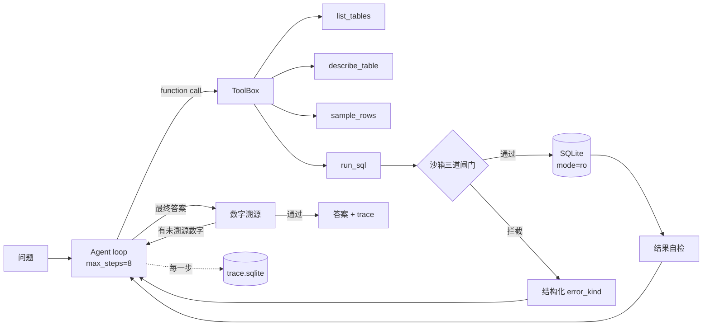

# DataAgent

**不是让 LLM 写 SQL，而是让它在写错的时候知道自己是错的。**

一个带护栏的自然语言查数 Agent。数据用 Olist 巴西电商库（9 张表 / 99,441 单 / 198 MB SQLite），
通过 function calling 让模型自己决定查什么、遇到错误怎么修，全过程写进可查询的 trace。

## 为什么做这个

第一次跑通就有答案，而且是错的：

| 轮次 | 模型给出的答案 | 实际值 | 错在哪 |
|---|---|---|---|
| 1 | 取消率 **6.25%** | 0.63% | 拿到正确的 625 和 99441 之后**心算相除错了一个数量级** |
| 2（加了数字溯源后） | 取消率 **62500%** | 0.63% | 改写 SQL 时 `count(*)` 漏了 `FROM`，SQLite 里恒等于 1，分母变成 1 |
| 3（加了聚合自检后） | "0.63%，**即 63%**" | 0.63% | 单位自相矛盾 |

三次都不是 SQL 语法错，SQL 全都能跑通、都有数据返回。这就是 LLM 最危险的失败模式：
**不报错、很自信、结果错。** 所以这个项目的重心不在"能不能生成 SQL"，而在
"生成之后能不能发现自己是错的"。

## 五道防线

| 防线 | 位置 | 挡住什么 | 实测 |
|---|---|---|---|
| 1. AST 校验 | `sandbox.validate_sql` | 写操作、多语句、未知表、`load_extension` 类函数 | DELETE/UPDATE/PRAGMA 全部拒绝 |
| 2. 只读连接 | `mode=ro` + `PRAGMA query_only` | 校验被绕过时的兜底写入 | 单测覆盖 |
| 3. 执行期中断 | `set_progress_handler` | 无 where 的笛卡尔积（geolocation 100 万行） | 递归 CTE 0.3s 被中断，连接仍可用 |
| 4. 结果自检 | `tools.self_check` + 重复调用检测 | `empty_result` / `suspicious_zero` / `aggregate_without_from` / `suspicious_ratio` / `repeated_call` | 抓住第 2 轮那个 `count(*)` 分母 |
| 5. 数字溯源 | `verify.unsourced_numbers` | 答案里出现但查询结果中没有出处的数字 | 抓住第 1 轮的心算，打回重算一次 |

关键取舍：**`ok=True` 而 `error_kind='empty_result'`**。
"SQL 能跑通"和"答案是对的"是两件事，混在一起就失去了诊断价值。

## 架构



trace 从第一行代码就落库（`runs` / `steps` 两张表，含 `error_kind`、token、耗时、成本）。
下一个项目 AgentEval 直接吃这张表做采样噪声与显著性分析。

## 快速开始

```powershell
uv venv .venv --python 3.13
uv pip install --python .venv\Scripts\python.exe -r requirements.txt

copy .env.example .env      # 填 DATAAGENT_API_KEY 和 DATAAGENT_DB

# 不消耗 token 的三个命令
.\run.cmd schema
.\run.cmd sql "select order_status, count(*) n from orders group by 1 order by n desc limit 5"
python evals\run_eval.py --gold-only        # 现场执行 60 条参考 SQL 生成金标准

# agent
.\run.cmd ask "被取消的订单占全部订单的比例是多少？" -v
python evals\run_eval.py                    # 跑全量评测
python evals\analyze_trace.py               # 从 trace 算命中率与修复率
python evals\recompute.py                   # 改判对口径后离线重算，不重跑模型
```

## 当前结果（60 题基线）

模型 `glm-4-flash`，prompt `v0.2.0`，`evals/baselines/glm-4-flash-60q-v0.2.0.json`（已随仓库提交）：

| 指标 | 值 |
|---|---|
| 准确率 | **0.483（29/60）** |
| 平均轮次 | 5.2（max_steps=8） |
| 总 token | 1,153,499 |
| 总成本 | ¥0（免费模型） |

按难度，这条曲线是整个项目最有价值的一张图：

| 难度 | 准确率 | 说明 |
|---|---|---|
| easy（15） | **0.933** | 单表 count / max / 过滤，基本没问题 |
| medium（15） | **0.467** | 多表 join、时间切片、比率，掉一半 |
| hard（15） | **0.333** | 三表 join + 窗口函数 + 条件聚合 |
| ambiguous（15） | **0.200** | 口径题（"最赚钱的类目""活跃客户"）几乎全军覆没 |

失败 31 题的结构比准确率本身更有信息量：

| 失败类型 | 数量 | 含义 |
|---|---|---|
| 打满 8 步未收敛 | 12 | 模型卡在循环里，拿不到答案 |
| 给出了答案但答错 | 19 | 包括口径偏差、数字算错、类目名中英不一致、以及"抱歉我算不出来" |

**注意第二种比第一种更多**——也就是说护栏没能拦住"自信地给出错误答案"，
这恰好说明只做结果自检是不够的，还需要答案级的校验（已有数字溯源，但只覆盖了数字）。

## 护栏效果：一条反直觉的结论

`python evals/analyze_trace.py` 从 79 次运行 / 329 次工具调用里算出来：

| 指标 | 值 |
|---|---|
| 护栏命中 | 190 次（占工具调用 **57.8%**） |
| 重试后成功 | 47 |
| 重试后仍失败 | 107 |
| 步数耗尽未再尝试 | 36 |
| **修复率** | **30.5%（47/154 次重试机会）** |

失败模式分布：

| error_kind | 次数 | 占比 |
|---|---|---|
| `repeated_call` | 117 | **61.6%** |
| `unknown_column` | 29 | 15.3% |
| `aggregate_without_from` | 13 | 6.8% |
| `misuse_aggregate` | 6 | 3.2% |
| `suspicious_zero` | 6 | 3.2% |
| `syntax` | 5 | 2.6% |
| 其余（`empty_result` / `suspicious_ratio` / `blocked` / `ambiguous_column` / `sqlite_error` / `unknown_function`） | 14 | 7.3% |

**两条反直觉的结论**：

1. **护栏信号的 61.6% 不是"SQL 写错"，而是"模型卡住了"。**
   重复调用（同一条 SQL 或同一个 `describe_table`）是最主要的问题类型，
   而这类问题靠"提示它写错了"是解决不了的——它需要的是换策略，不是改语法。

2. **护栏能让错误可见，但修复率只有 30.5%。**
   "让模型知道自己错了"和"模型有能力改对"是两件完全不同的事。
   一个只报准确率的项目会假装这两件事是一件事；分开量化之后，
   问题就变成可实验的：换更强的模型，修复率会从 30.5% 涨到多少？
   如果涨不动，瓶颈在提示策略；如果涨很多，说明护栏的价值取决于模型能力。
   这就是下一个项目 AgentEval 要回答的问题。

## Decision Log

- **schema 全塞进上下文，不做向量检索**：9 张表的 DDL + 列注释 + 样例值只有 5.1 KB，
  检索反而会漏表。表数上到几十张、schema 过百 KB 时才值得上 RAG。
- **不引入 LangChain/LangGraph**：loop 只有一百多行，控制流自己握着才能定位
  "模型在哪一步走错"。框架对比实验留到后期用 LangGraph 复刻同一套评测。
- **数字溯源只重试一次**：第二次仍失败就如实标记 `unsourced` 并输出，
  而不是无限重试——无限重试会把失败藏起来，还会烧钱。
- **判对口径改了两次，所以做了 `recompute.py`**：第一版按数字覆盖率判对，
  模型答对 9803 但顺带报了两个真实数字就被判错；第二版改为"命中金标准主值"。
  口径改了却没有离线重算能力，等于所有历史数据作废——这件事本身就是 AgentEval 要解决的。
- **数值容差 0.1%**：1% 的容差会把 16057.76（金额错 100 倍）判成 160.99 的命中。
- **trace 用 SQLite 而不是接 Langfuse**：本地可查询、零依赖，需要可视化时再导出 OTel。
- **prompt_version 参与缓存 key**：改提示词必须同步升版本号，
  否则只会读回旧缓存，实验数据全部作废（这个坑在之前的 LLM 标注项目里踩过）。

## 已知局限

1. `glm-4-flash` 的心算与单位换算是明显短板：三次首轮失败都出在这一层，
   口径题（ambiguous 0.20）也基本是它拖的。
2. 数字溯源只能验证"有没有出处"，验证不了"这条 SQL 语义对不对"——
   62500% 那次有出处但仍是错的，靠的是防线 4 而不是防线 5。
3. 判对口径仍是启发式的（主值匹配 + 覆盖率），ambiguous 题里"模型给了另一种自洽口径"
   会被判错，需要人工抽检才能给出可信的准确率区间。
4. 没有并发、没有服务化、没有 CI；60 题串行跑 27 分钟。

## Roadmap

- [ ] 模型对照实验：`glm-4-flash` / `glm-4-plus` / `deepseek-chat` 跑同一套 60 题，
      量化同一套护栏下不同模型的**修复率**差异（最有信息量的一格）
- [ ] 针对 `repeated_call` 的专项改进：既然 61.6% 的信号是"卡住"，
      就该在重试时强制换策略（重读 schema / 换工具 / 重新规划），而不是只提示"换写法"
- [ ] 二十题人工抽检，给出准确率的置信区间而不是单点值
- [ ] FastAPI 服务化 + Docker
- [ ] 打包成 MCP server，在 Cursor / Reasonix 里直接查数
- [ ] 失败模式分类报告（数据源就是 trace 表的 `error_kind`）
